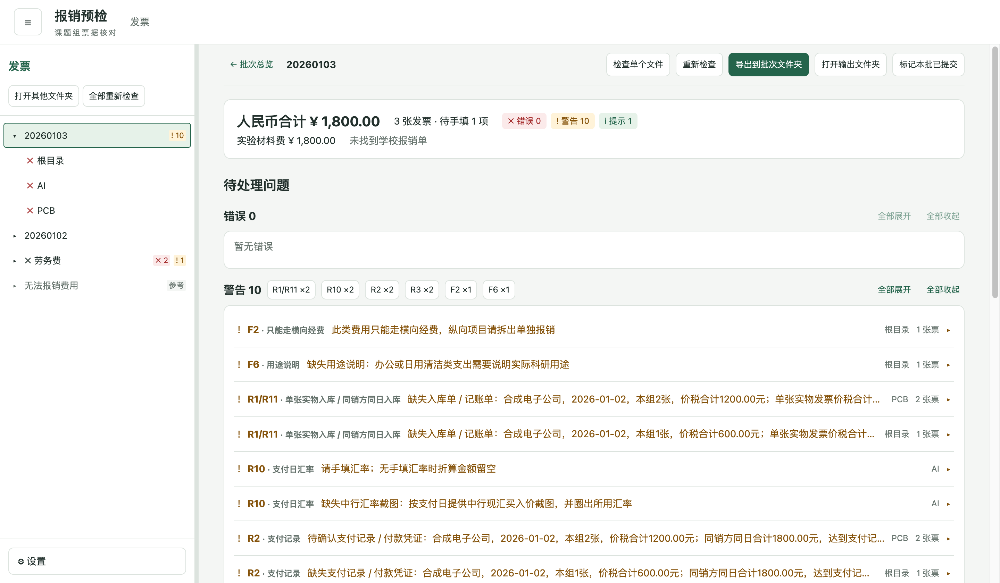
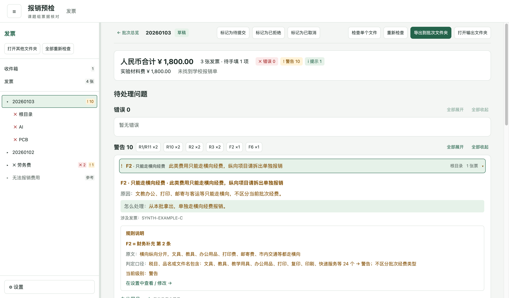
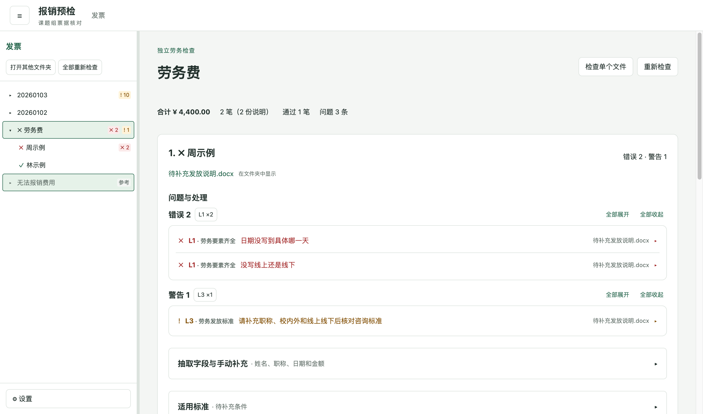
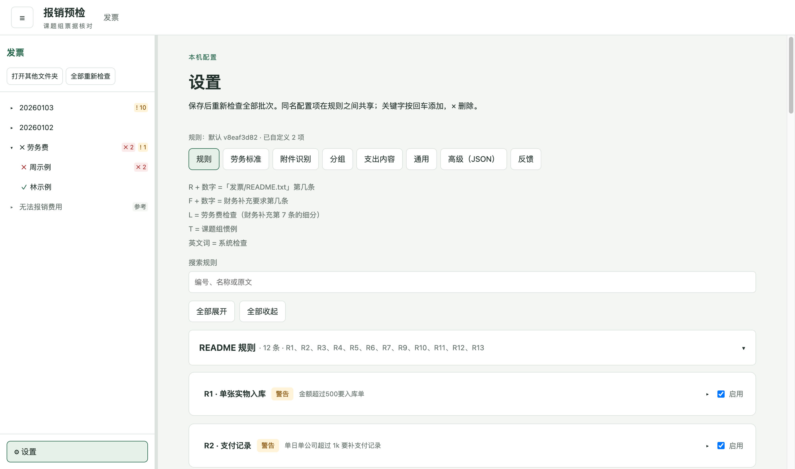

# 报销预检

面向西安交通大学用户的非官方桌面工具，在本机检查发票、报销材料和劳务费说明。

An unofficial desktop pre-check tool for reimbursement documents at Xi'an Jiaotong University.
It parses invoices, checks configurable rules, and prepares material lists locally.
It supports macOS and Windows without a server or automatic uploads.
Pre-check results do not guarantee reimbursement approval.

> **非官方声明：本项目不是西安交通大学官方工具。规则整理自课题组经验和财务处公开要求，以财务处最新规定为准；工具只做预检，不保证报销通过。**

## 界面

以下截图使用合成票据和示例工作区，不含真实报销资料。维护者可用 `npm run screenshots` 生成或更新。






## 能做什么

- 解析带文字层的电子发票 PDF、数电票 XML 和可识别的 OFD，按发票号合并多种格式；支持部分海外收据。
- 核对抬头、金额、重复票据、拒票记录、支出内容和材料要求。材料分为“已找到 / 待确认 / 缺失”。
- 独立检查劳务情况说明：姓名、职称、日期、线上线下、金额及两套标准；生成 Word 草稿。
- 确认未命名附件，手填外币与汇率，从中行历史牌价页截取带红圈的价格。
- “放入改好的文件”先在临时副本预检，通过后放入原目录、归档旧版，并支持撤销。
- 导出入库登记清单、高值材料明细、Markdown 汇总；在本机记录已提交历史。
- 标记“这条不对”，预览并导出脱敏反馈包，由用户自己发送给维护者。

详细操作见 [使用说明](docs/使用说明.md)。扫描件和截图不做 OCR，附件内容仍需人工核对。

## 下载安装

到 [GitHub Releases](https://github.com/AuthonyL/xjtu-reimburse-precheck/releases) 下载。标有 Pre-release 的版本是预发布版本，先使用资料副本检查。

| 电脑                                                  | 文件名后缀          |
| ----------------------------------------------------- | ------------------- |
| Apple 芯片 Mac（苹果菜单 → 关于本机 → 芯片 Apple M…） | `mac-arm64.dmg`     |
| Intel Mac（关于本机 → 处理器 Intel…）                 | `mac-x64.dmg`       |
| Windows x64                                           | `win-x64-setup.exe` |

Mac 打开 dmg 后拖到“应用程序”；Windows 运行安装向导，可选择安装目录。下载后可对照同一 Release 的 `SHA256SUMS.txt` 校验文件。

应用没有付费开发者签名，也没有 Apple 公证。只对来源和校验和均已确认的文件执行以下步骤：

- Mac：右键应用 →“打开”；仍被拦截时，在“系统设置 → 隐私与安全性”点“仍要打开”。提示“已损坏”时，在终端执行 `xattr -cr "/Applications/报销预检.app"` 后重试。
- Windows SmartScreen：点“更多信息 → 仍要运行”。

## 文件夹怎么放

```text
发票/
  20260102/                 # 一个批次，也可以用项目或用途命名
    转接线.pdf             # 散票归入“根目录”组
    PCB/
      发票.xml
      支付记录.jpg
      记账单.pdf
    AI/
      海外收据.pdf
      订阅说明.png
      汇率.png
  示例项目/
    市内交通/
      示例电子发票.pdf
      示例行程单.pdf
    委托加工/
      发票.pdf
      对方盖章明细清单.pdf
  劳务费/                  # 独立走劳务检查
    示例人员发放说明.docx
    发放表.pdf
  无法报销费用/            # 拒票参考，不混入批次合计
```

根目录的一级文件夹按内容作为批次，不要求日期名称；劳务、拒票、`tmp`、`_预检`、隐藏目录和空目录除外。批次按开票日期等信息倒序排列。名字中含“横向”不会跳过经费提示。

第一次选择或拖入目录，以后启动自动恢复。导出、手填、附件确认、汇率截图和旧版归档保存在对应目录的 `_预检/`。设置、最近工作区、提交历史和反馈标记保存在系统的 Electron `userData` 目录，实际位置可在设置页查看。

## 规则从哪里来

| 编号     | 含义                                 |
| -------- | ------------------------------------ |
| R + 数字 | 课题组原始发票规则清单的条目编号     |
| F + 数字 | 财务补充要求编号                     |
| L        | 劳务费检查，是财务第 7 条的细分      |
| T        | 课题组惯例，如行程单、运单明细       |
| 英文编号 | APP 自身的检查，如解析告警、重复票据 |

展开问题可看原文、当前判定口径及处理办法。“设置 → 规则”支持搜索编号、开关、级别、关键字和阈值；其他标签可改附件识别、分组、支出内容、劳务标准。可导入、导出规则 JSON 在课题组内共享。默认高值材料理由是通用模板，必须按真实用途填写。

## 隐私

发票只在本机处理，不联网、不上传、没有遥测；用户主动打开的中行牌价页除外。中行验证码由用户自己完成。

反馈包会对可识别的个人信息脱敏，默认不附原文件；公司、税号、金额和日期仍保留。导出前请检查预览，脱敏不能代替人工检查。勾选“附带原文件”会保留原文件内容，不能将这样的包直接发到公开 Issue。

## 反馈与贡献

解析失败、误报或规则建议可提交 [Issue](https://github.com/AuthonyL/xjtu-reimburse-precheck/issues)。请说明操作系统、APP 版本和复现步骤；解析问题优先提供经你检查后的反馈包，与维护者约定私密发送方式。不要公开真实发票或个人信息。

提交代码前请阅读 [贡献说明](CONTRIBUTING.md)。政策解释和材料有效性仍需与财务人员确认。

## 开发

Node.js 24、npm、Electron、React、TypeScript。运行方式、测试、打包及维护者工具见 [开发说明](docs/开发说明.md)。跨平台检查和界面冒烟测试由 GitHub Actions 执行；推送 `v1.2.3` 这样的版本标签会在验证后发布正式版（Latest），带后缀的标签（如 `v1.2.3-beta.1`）发布为预发布；具体是否通过以对应 Actions 日志为准。

## 许可证

[MIT](LICENSE)。依赖软件按各自许可证分发，安装包附有第三方许可文本。
